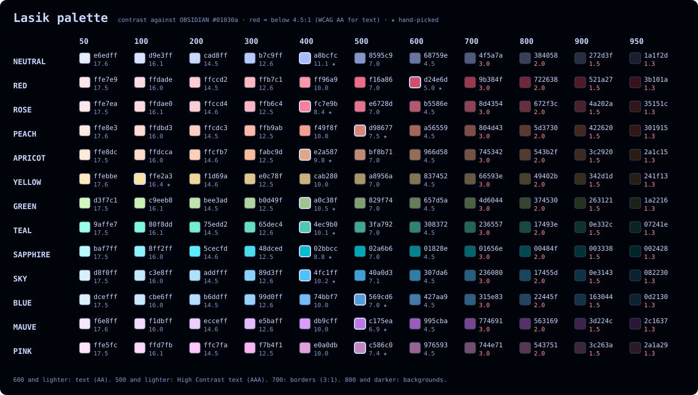

# lasik palette

The colors behind the Lasik themes for [VS Code](https://github.com/aamnah/lasik-vscode-theme) and [Konsole](https://github.com/aamnah/lasik-konsole-theme). Lasik is a dark theme made for sensitive eyes: comfortable for reading a lot of text, with good contrast.



All colors are in [`palette.toml`](./palette.toml). Each color has up to five tiers, named after what the color is:

| Tier | Example | What it is |
|---|---|---|
| Muted | `RED_MUTED` | same lightness, less colorful (the color mixed with gray) |
| Base | `RED` | the main color |
| Deep | `RED_DEEP` | darker and richer |
| Bright | `RED_BRIGHT` | lighter, used for bright terminal colors |
| Quiet | `RED_QUIET` | 35% of the base color mixed into the background. Below WCAG contrast, so only the opt-in Lasik Dark Quiet variant uses it |

Each program names its color slots differently (Konsole "Intense", VS Code "ansiBright", Alacritty "bright"), so the themes decide which tier goes where.

Contrast is measured against the background, `OBSIDIAN` `#01030a`. Changes are listed in [CHANGELOG.md](./CHANGELOG.md).

## How the tiers are made

Most colors were picked by hand. The rest were calculated from the base color with the formulas below, then **stored** in `palette.toml` (they're not recalculated when you change a base color).

### Two color models

- **OKLCH** for lightness and colorfulness. It describes a color with three numbers that match how people see it:
  - **L**: lightness, from 0 (black) to 1 (white)
  - **C**: chroma, how colorful it is (0 = gray)
  - **H**: hue, the color angle in degrees (red ≈ 10°, yellow ≈ 90°, blue ≈ 245°)

  Changing L in OKLCH makes a color look lighter or darker without its hue drifting. That doesn't work in RGB or HSL. ([OKLab by Björn Ottosson](https://bottosson.github.io/posts/oklab/), the base of OKLCH.)
- **sRGB** (normal hex colors) for mixing with the background, because that's how a screen blends a see-through color.

When a calculated color is too colorful for a normal screen (outside sRGB), its chroma is lowered in small steps (0.002) until it fits. Hue and lightness stay the same.

### Formulas

| Tier | How it's made | Hand-picked range | Formula for new colors |
|---|---|---|---|
| **MUTED** | same lightness, less colorful | chroma 0.27× (GREEN) to 0.69× (BLUE) | `L` same, `C × 0.556`, `H` same |
| **DEEP** | darker and more colorful | 8 colors: `L` −0.04 to −0.08, chroma 1.05× to 1.49× | `L − 0.076`, `C × 1.31`, `H` same |
| **BRIGHT** | lighter | none (all calculated) | `L + 0.08` (at most 0.97), `C` same, `H` same |
| **QUIET** | mixed into the background | none (all calculated) | for each of R, G, B: `0.35 × color + 0.65 × OBSIDIAN` |

- **The numbers come from the hand-picked colors.** 0.556 is the median chroma ratio of 11 hand-picked muted colors (SLATE is left out: its muted color was made lighter in May 2026, not less colorful). −0.076 and 1.31 are the medians of the 8 hand-picked deep colors that are darker *and* more colorful (RED, PEACH, TUMBLEWEED, YELLOW, GREEN, BLUE, MAUVE, PINK). TEAL, SAPPHIRE and SLATE deep are darker but less colorful, so they were left out of the median.
- **QUIET's 35%** is the opacity the VS Code theme already used for dimmed JSON quotes. Mixing into the background (instead of making the color see-through) gives one solid color that looks the same everywhere.
- **Contrast** is the WCAG 2 formula: `(L1 + 0.05) / (L2 + 0.05)`, where L1 and L2 are the relative luminance of the lighter and the darker color. It goes from 1:1 to 21:1.

### Hand-picked or calculated

| Tier | Hand-picked | Calculated |
|---|---|---|
| Base | all 17 (APRICOT, ROSE, SKY, PERIWINKLE and SILVER came from the old VS Code theme) | none |
| MUTED | the 12 original colors | APRICOT, ROSE, SKY, PERIWINKLE. SILVER has none: it's a gray, so there is no color to take away |
| DEEP | the 11 original colors except LAVENDER | LAVENDER, APRICOT, ROSE, SKY, PERIWINKLE, SILVER |
| BRIGHT | LAVENDER (`#e8ecfd`, its original intense color) | all others |
| QUIET | none | all except SLATE |

### Exceptions

- **`YELLOW_BRIGHT`** uses `L + 0.02` and `C × 1.1` instead of `L + 0.08`, because yellow is already very light: +0.08 would make it almost white.
- **`LAVENDER_BRIGHT`** keeps the hand-picked `#e8ecfd`. Lavender is the terminal text color, and anything lighter gets close to pure white, which causes a halo around letters on a dark background.
- **`SLATE_BRIGHT`** is `SLATE_MUTED` made lighter (only `L` goes up) until it reaches 5.0:1. Bright black is used for shell suggestions and git hints, so it has to be readable.
- **`SLATE_QUIET`** is `#2a324b` (the hand-picked dark slate) instead of the 35% mix, which would be `#161b2c` (1.2:1), too close to the background to see.

## Update the image

The image is generated from `palette.toml`, so it always matches the palette. After changing a color, run this from the repo root:

```sh
deno run --allow-read --allow-write scripts/render-palette.ts
```
